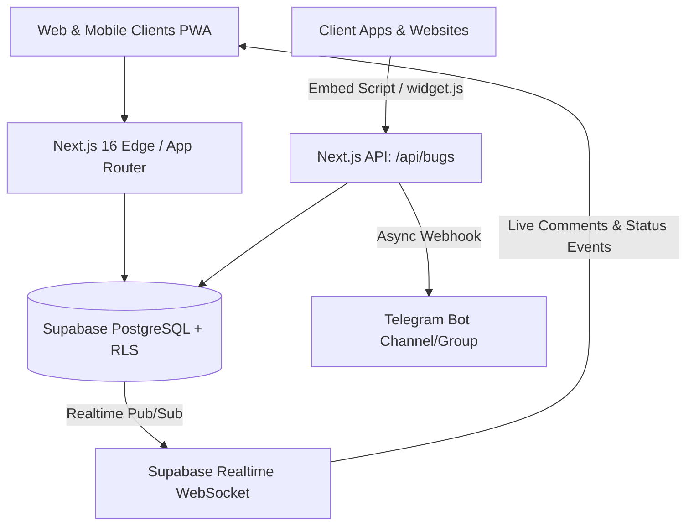

# ARCHITECTURE.md — IFoundBug (IFB) Enterprise Specification

## 1. Executive Topology & Architecture
IFoundBug is engineered as a zero-latency, high-concurrency collaborative bug tracking and developer triage platform. It replaces informal, unstructured communication channels (such as chaotic Telegram groups) with deterministic, telemetry-backed bug lifecycles.

---

## 2. Core Architectural Pillars

### A. Non-Volatile Client Diagnostics & Telemetry
Whenever a tester or developer records a defect, the client captures:
- Viewport and native physical device resolution
- Operating system release string
- User-Agent, browser engine, and rendering vendor
- System network latency & connection type
- Interface locale & active locale string

### B. In-Browser Image Annotation Engine
An HTML5 Canvas rendering pipeline (`ImageAnnotator.tsx`) operates client-side:
- **Zero-Roundtrip Processing**: Operates entirely in memory with 60FPS draw cycles.
- **PII Obfuscation Layer**: Renders dark blurring bounding boxes over confidential credentials, phone numbers, or tokens before persistence.
- **State Stacking**: 10-level non-destructive undo buffer using canvas `ImageData`.

### C. AI Coding Agent Prompt Synthesizer
Directly transforms raw defect metadata into structured instructions compatible with:
- **Claude Code** (`claude ...`)
- **Cursor IDE**
- **Codex / Antigravity Agents**
- Generates reproducible steps, expected vs actual behavior, acceptance checklists, and path references.

### D. Multi-Tenant Workspace & Secure Tokenized Invites
- **Row Level Security (RLS)**: Enforces access controls across public and private workspaces.
- **Tokenized Invites**: Cryptographic tokens grant role-restricted access (`owner`, `admin`, `developer`, `qa_tester`, `viewer`).

---

## 3. Database Schema Overview
- `ifb_profiles`: User identities, roles, reputation scores.
- `ifb_projects`: Multi-tenant workspaces with webhook endpoints and tech stack metadata.
- `ifb_project_members`: Workspace team association with strict RBAC.
- `ifb_project_invites`: Tokenized share links with auto-expiring usage counts.
- `ifb_bugs`: Defect items with telemetry JSONB, acceptance checklists, and AI prompts.
- `ifb_bug_comments`: Discussion threads with markdown and emoji reactions.
- `ifb_bug_audit_logs`: Audit trail for compliance and status histories.
- `ifb_bug_upvotes`: Community reproduction and upvoting counters.
